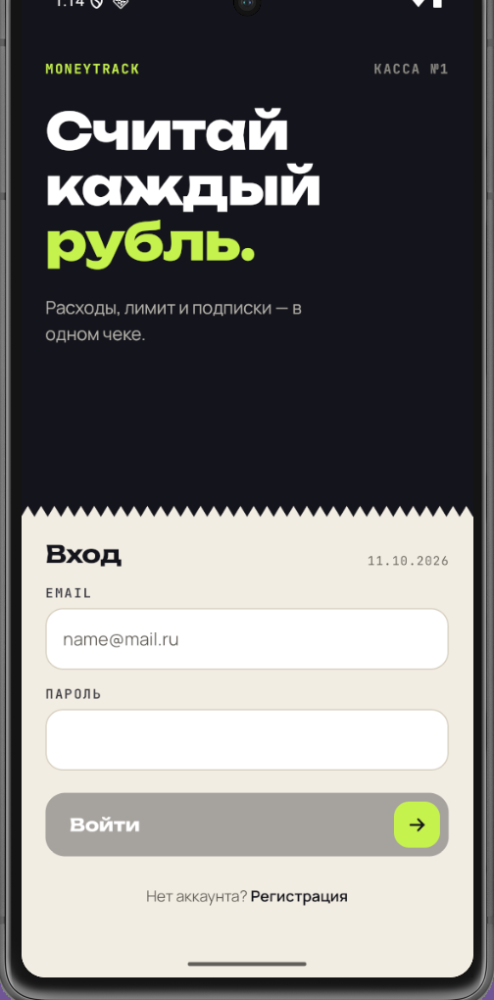
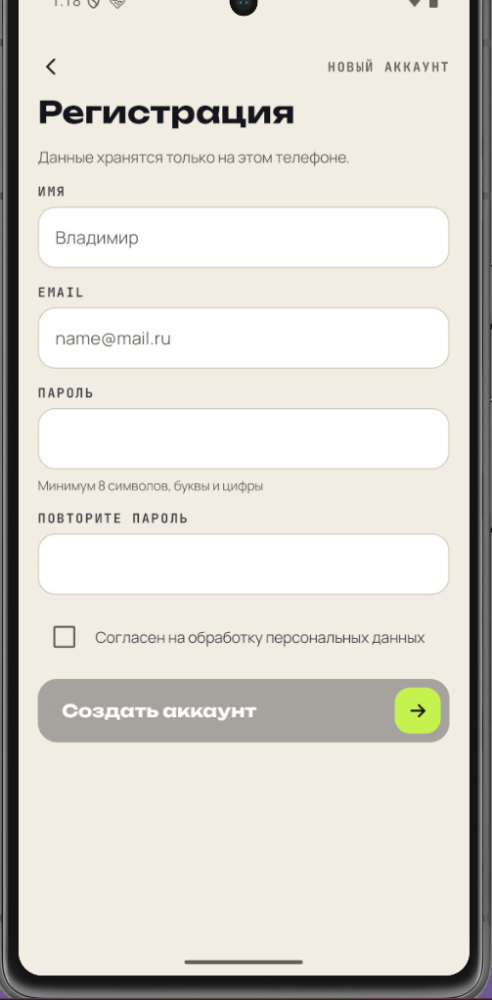
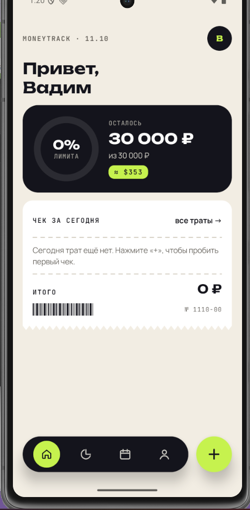
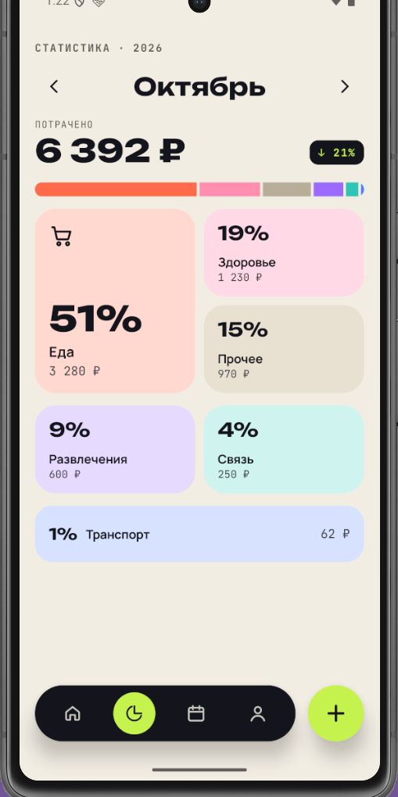
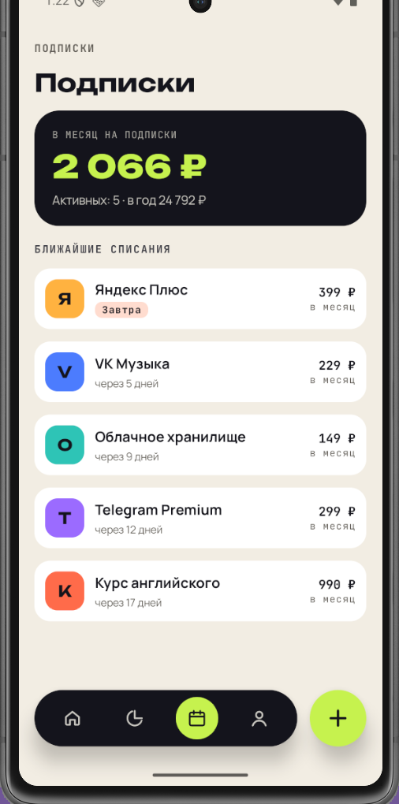
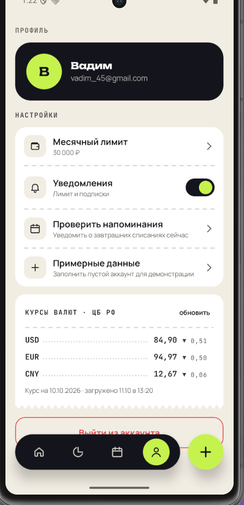
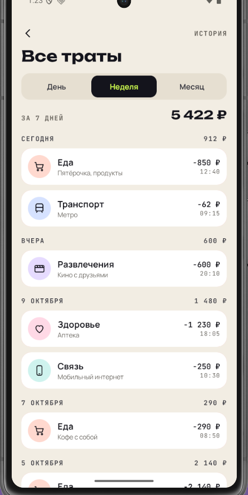
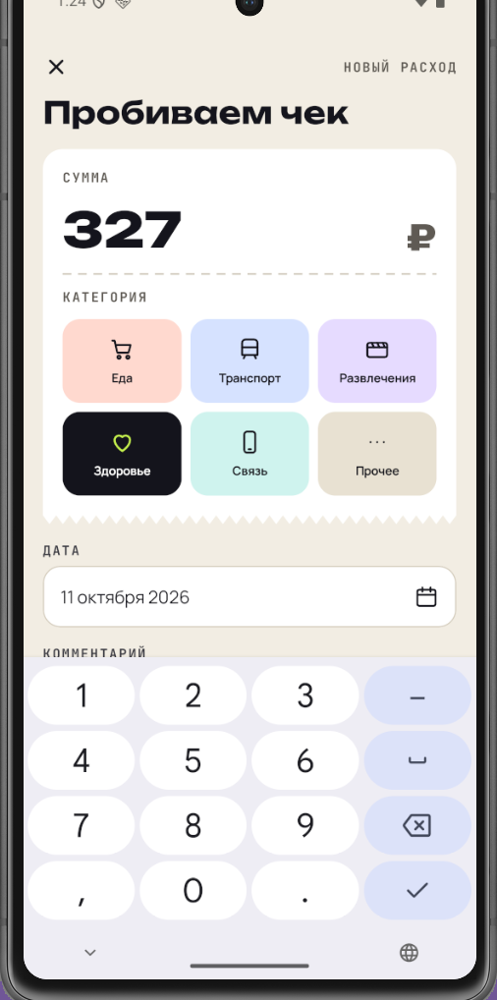
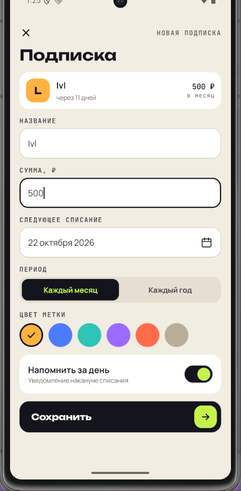
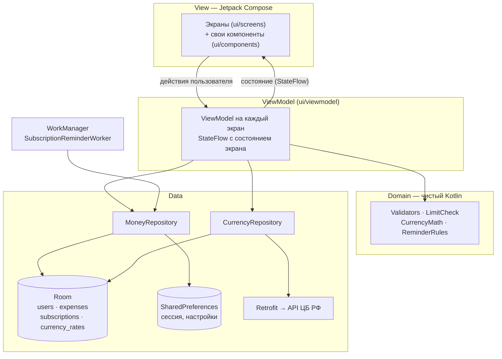

# MoneyTrack — трекер расходов

Мобильное приложение для Android, в котором можно вести учёт личных расходов, контролировать регулярные подписки и следить за месячным бюджетом.

Учебный проект по дисциплине «Разработка мобильного приложения» (БГТУ «ВОЕНМЕХ», кафедра Н2).

[](https://github.com/aleshinvadim111-jpg/MoneyTrack/releases/latest)


---

## Содержание

- [Возможности](#возможности)
- [Скриншоты](#скриншоты)
- [Установка и запуск](#установка-и-запуск)
- [Архитектура](#архитектура)
- [Структура проекта](#структура-проекта)
- [Используемые библиотеки](#используемые-библиотеки)
- [Тестирование](#тестирование)
- [Обфускация и защита](#обфускация-и-защита)
- [Дизайн](#дизайн)
- [Команда](#команда)

---

## Возможности

**Учётная запись**
- регистрация по email и паролю (пароль — от 8 символов, хотя бы одна буква и одна цифра);
- пароли хранятся только в виде хэша (PBKDF2 с солью);
- сессия сохраняется после перезапуска приложения, есть выход из аккаунта.

**Расходы**
- добавление траты: сумма, категория, дата, комментарий (до 200 символов);
- шесть категорий: Еда, Транспорт, Развлечения, Здоровье, Связь, Прочее;
- редактирование по тапу на трату, удаление свайпом с кнопкой «Отменить» или из формы с подтверждением;
- «Чек за сегодня» на главном экране и история трат по дням с фильтром «День / Неделя / Месяц».

**Статистика и бюджет**
- сумма за месяц и разбивка по категориям с диаграммой;
- сравнение с прошлым месяцем;
- месячный лимит с кольцом прогресса: от 80 % плашка становится персиковой, после превышения — красной, в момент пересечения порога приходит системное уведомление.

**Подписки**
- название, сумма, период (месяц или год) и дата списания; после списания дата автоматически сдвигается на следующий период;
- список подписок с ближайшими датами списания и общей суммой в месяц;
- напоминание за день до списания (WorkManager, ежедневная проверка в 10:00).

**Курсы валют**
- курсы USD, EUR и CNY с сервера ЦБ РФ с изменением за день;
- пересчёт суммы трат на главном экране в доллары;
- курсы кэшируются в базе: без интернета показывается последний сохранённый курс.

**Прочее**
- контекстная кнопка «+»: на вкладке «Подписки» добавляет подписку, на остальных — расход;
- кнопка «Примерные данные» в профиле для быстрой демонстрации;
- переключатель уведомлений и запрос разрешения на уведомления (Android 13+).

---

## Скриншоты

<!-- Файлы лежат в docs/screenshots/. Размер — скриншот эмулятора Pixel 7 (1080×2400). -->

| Вход | Регистрация | Главная |
|:---:|:---:|:---:|
|  |  |  |

| Статистика | Подписки | Профиль |
|:---:|:---:|:---:|
|  |  |  |

| История | Новый расход | Новая подписка |
|:---:|:---:|:---:|
|  |  |  |

---

## Установка и запуск

### Вариант 1. Готовый APK

1. Откройте страницу [Releases](https://github.com/aleshinvadim111-jpg/MoneyTrack/releases/latest) и скачайте `MoneyTrack-1.0.apk`.
2. Перенесите файл на телефон (или перетащите APK в окно эмулятора).
3. Разрешите установку из неизвестных источников, если система спросит, и установите приложение.
4. При первом запуске зарегистрируйтесь. Чтобы сразу увидеть заполненные экраны, нажмите в профиле «Примерные данные».

> Требуется Android 7.0 (API 24) или новее. Если на устройстве уже стоит debug-версия, сначала удалите её: у сборок разные подписи, и поверх она не установится.

### Вариант 2. Сборка из исходников

**Что понадобится**
- Android Studio Quail 4 (2026.1.4) или новее — JDK входит в комплект;
- Android SDK Platform 37;
- эмулятор или телефон с Android 7.0+.

**Шаги**

```bash
git clone https://github.com/aleshinvadim111-jpg/MoneyTrack.git
```

1. В Android Studio: **File → Open** → папка `MoneyTrack`.
2. Дождитесь синхронизации Gradle (или нажмите **Sync Now**).
3. Выберите устройство и нажмите **Run ▶** — соберётся и установится debug-версия.

То же самое из терминала:

```bash
./gradlew assembleDebug        # APK: app/build/outputs/apk/debug/app-debug.apk
./gradlew installDebug         # установка на подключённое устройство
./gradlew test                 # юнит-тесты
```

**Release-сборка.** Ключ подписи в репозиторий не входит (`*.jks` в `.gitignore`). Чтобы собрать подписанный release-APK со своим ключом: **Build → Generate Signed App Bundle or APK → APK → release**. Файл появится в `app/release/`, таблица переименований R8 — в `app/build/outputs/mapping/release/mapping.txt`.

---

## Архитектура

Приложение построено по схеме **MVVM** (Model — View — ViewModel) с однонаправленным потоком данных:



**View** (Jetpack Compose) только отображает состояние и передаёт действия пользователя во ViewModel, бизнес-логики в ней нет.

**ViewModel** — у каждого экрана своя (`HomeViewModel`, `StatsViewModel`, `HistoryViewModel`, `SubscriptionsViewModel`, `ProfileViewModel`, `ExpenseFormViewModel`, `SubscriptionFormViewModel`, `AuthViewModel`, `SessionViewModel`). Она обрабатывает события, проверяет ввод и отдаёт экрану готовое состояние через `StateFlow`.

**Domain** — правила без зависимостей от Android: проверка полей, расчёт уровня лимита (норма / 80 % / превышение), пересчёт валют, выбор подписок для напоминания. Именно этот слой покрыт юнит-тестами.

**Data** — репозитории скрывают от ViewModel, откуда берутся данные:
- `MoneyRepository` — пользователи, траты и подписки в Room, текущая сессия в SharedPreferences;
- `CurrencyRepository` — курсы из сети с кэшем в Room: запрос к серверу не чаще раза в час, при ошибке сети отдаётся сохранённый курс.

**Внедрение зависимостей — вручную.** Долгоживущие объекты (база, репозитории, сетевой клиент, `Notifier`, `ReminderScheduler`) создаются один раз в `AppContainer` при старте `MoneyTrackApplication` и передаются во ViewModel через `AppViewModelFactory`. Для проекта такого размера это проще, чем Hilt, и не требует генерации кода.

**База данных.** Room, версия схемы 2. Таблица `currency_rates` добавлена миграцией 1 → 2, существующие данные пользователя при обновлении сохраняются.

**Навигация.** Navigation Compose: экраны входа и регистрации, четыре вкладки в плавающей нижней панели (Главная, Статистика, Подписки, Профиль), История и формы. Формы открываются по маршрутам `expense_form?id={id}` и `subscription_form?id={id}`: без `id` — создание, с `id` — редактирование.

---

## Структура проекта

```
app/src/main/java/com/example/moneytrack/
├── MainActivity.kt
├── MoneyTrackApplication.kt      # создаёт AppContainer, планирует напоминания
├── AppContainer.kt               # ручной DI
├── data/
│   ├── AppDatabase.kt            # Room, миграция 1→2
│   ├── Entities.kt, Daos.kt
│   ├── MoneyRepository.kt, CurrencyRepository.kt
│   ├── SessionManager.kt         # SharedPreferences
│   ├── PasswordHasher.kt         # PBKDF2 + соль
│   ├── Dates.kt
│   └── network/                  # CbrApi (Retrofit + DTO), NetworkModule
├── domain/                       # Validators, LimitCheck, CurrencyMath, ReminderRules
├── model/                        # User, Expense, Subscription, Category, CurrencyRate
├── notifications/                # Notifier, SubscriptionReminderWorker, ReminderScheduler
└── ui/
    ├── navigation/               # AppNavigation: NavHost и маршруты
    ├── viewmodel/                # ViewModel экранов + AppViewModelFactory
    ├── screens/                  # 9 экранов
    ├── components/               # BudgetRing, FloatingNavBar, ReceiptCard, SwipeExpenseCard и др.
    └── theme/                    # цвета, шрифты, тема
```

### Собственные UI-компоненты

| Компонент | Что делает |
|---|---|
| `BudgetRing` | Кольцо прогресса лимита, нарисованное на Canvas; цвет меняется при 80 % и при превышении |
| `ReceiptCard` | Карточка в виде кассового чека с зубчатым краем (свои `Shape`: `ZigzagTopShape`, `ZigzagBottomShape`) |
| `SwipeExpenseCard` | Карточка траты с удалением свайпом и возможностью отменить удаление |
| `FloatingNavBar` | Плавающая нижняя панель вкладок с контекстной кнопкой «+» |

---

## Используемые библиотеки

| Библиотека | Версия | Для чего |
|---|---|---|
| Kotlin | 2.2.10 | Язык разработки |
| Android Gradle Plugin | 9.4.1 | Сборка, R8 |
| Jetpack Compose (BOM) | 2026.02.01 | Декларативный UI |
| Material 3 | из BOM | Компоненты и тема |
| Activity Compose | 1.8.0 | Точка входа Compose в `MainActivity` |
| Navigation Compose | 2.10.2 | Навигация между экранами |
| Lifecycle ViewModel Compose | 2.9.0 | ViewModel и `StateFlow` в Compose |
| Room (runtime, ktx, compiler) | 2.8.4 | Локальная база данных SQLite |
| KSP | 2.3.10 | Генерация кода Room |
| Retrofit + Gson converter | 2.11.0 | Запросы к API ЦБ РФ и разбор JSON |
| WorkManager | 2.10.1 | Ежедневная фоновая проверка подписок |
| JUnit | 4.13.2 | Юнит-тесты |

**Внешний API:** [cbr-xml-daily.ru](https://www.cbr-xml-daily.ru/) — курсы валют ЦБ РФ в формате JSON (`/daily_json.js`), бесплатно и без ключа.

**Шрифты:** Unbounded (заголовки), Manrope (основной текст), JetBrains Mono (подписи и метки) — все под лицензией SIL Open Font License.

---

## Тестирование

Юнит-тесты лежат в `app/src/test/java/com/example/moneytrack/`: 6 классов, 29 тестов, все проходят.

| Класс | Что проверяется |
|---|---|
| `domain/ValidatorsTest` | Email, пароль, совпадение паролей, пустое имя, разбор суммы |
| `domain/LimitCheckTest` | Уровень лимита (норма / от 80 % / превышение), процент, уведомление только в момент пересечения порога |
| `domain/CurrencyMathTest` | Пересчёт рублей в валюту, неверный курс, формат курса и изменения за день, дата ЦБ, срок жизни кэша (1 час) |
| `domain/ReminderRulesTest` | Какие подписки попадают в напоминание на завтра |
| `data/PasswordHasherTest` | Верный и неверный пароль, хэш не содержит пароль, разная соль даёт разный хэш |
| `data/DatesTest` | Сдвиг даты списания на месяц и год (в том числе с 31-го числа), разница в днях |

Запуск: в Android Studio правой кнопкой по папке `test` → **Run 'Tests in moneytrack'**, или из терминала:

```bash
./gradlew test
```

---

## Обфускация и защита

- В release-сборке включён R8 (`optimization { enable = true }` в `app/build.gradle.kts` — новый DSL AGP 9.3+, заменяет `isMinifyEnabled` и `isShrinkResources`): код сжимается, оптимизируется и обфусцируется, неиспользуемые ресурсы удаляются. Release-APK весит 2,54 МБ.
- Свои правила — в `app/src/main/keepRules/rules.keep`: сохраняются DTO для Gson, имена enum, которые лежат в базе строками (`Category`, `SubPeriod`), конструктор `SubscriptionReminderWorker` и номера строк для разбора крэшей.
- Пароли хранятся только в виде хэша PBKDF2 с индивидуальной солью.

---

## Дизайн

Концепция «Чек»: бумажный фон, тёмный текст и яркий акцент, карточки в виде кассового чека с зубчатым краем.

| Цвет | HEX | Роль |
|---|---|---|
| Paper | `#F2EDE3` | Фон |
| Ink | `#17171C` | Текст, тёмные элементы |
| Lime | `#C6F24E` | Акцент |

Прототип в Figma: _ссылка будет добавлена_ <!-- TODO: вставить ссылку «Anyone with the link» -->

---

## Команда

| Участник | Роль |
|---|---|
| Алешин В.А. | <!-- TODO --> |
| <!-- TODO --> | <!-- TODO --> |
| <!-- TODO --> | <!-- TODO --> |

Группа О731Б, БГТУ «ВОЕНМЕХ» им. Д.Ф. Устинова, 2026.
